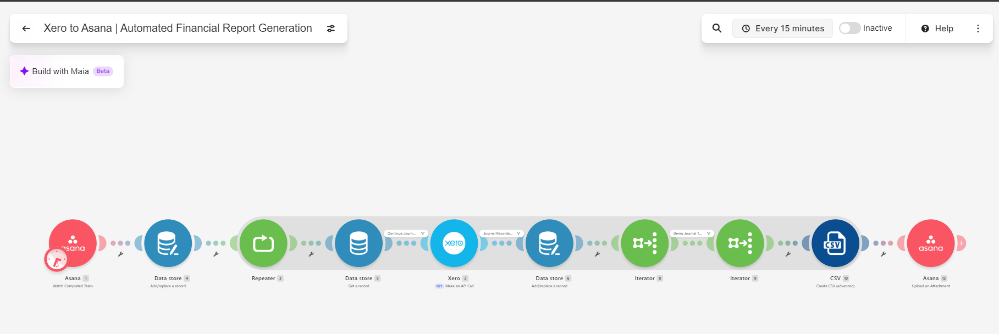

# Xero to Asana Financial Report Automation

### Automated Financial Data Extraction, CSV Generation & Task Attachment Using Make.com

## Project Overview

This project demonstrates an automated financial reporting workflow that connects **Asana, Xero, and Make.com**.

When an Asana task is marked as completed, the automation retrieves journal records from Xero, processes the financial data, generates a CSV report, and attaches the file to the originating Asana task.

The workflow was implemented and tested using Xero's demo organization with a **2026 reporting period**.

## Business Problem

Manual financial reporting involves retrieving accounting records, exporting transaction data, preparing reports, and uploading files to project management systems.

These repetitive activities can create delays and increase the risk of manual errors.

## Proposed Solution

An event-driven automation that:

1. Detects completed Asana tasks.
2. Initializes reporting and pagination state.
3. Retrieves journal records through the Xero API.
4. Processes records using iterators and date filters.
5. Generates a structured CSV financial report.
6. Uploads the generated CSV to the corresponding Asana task.

## Technology Stack

| Technology | Purpose |
|---|---|
| Make.com | Workflow orchestration |
| Asana | Task completion trigger and attachment destination |
| Xero API | Financial journal data retrieval |
| Make Data Store | Pagination state management |
| Iterator | Journal and journal-line processing |
| CSV Aggregator | Financial report generation |

## Workflow Architecture

```text
Asana — Watch Completed Tasks
             |
             v
Data Store — Initialize Pagination
             |
             v
Repeater — Pagination Cycles
             |
             v
Data Store — Retrieve State
             |
             v
Xero API — Retrieve Journals
             |
             v
Data Store — Update Pagination
             |
             v
Iterator — Journal Records
             |
             v
Filter — Reporting Year 2026
             |
             v
Iterator — Journal Lines
             |
             v
CSV — Generate Financial Report
             |
             v
Asana — Upload CSV Attachment
```

## CSV Report Structure

The generated report contains the following fields:

| Column | Description |
|---|---|
| JournalNumber | Xero journal reference number |
| JournalDate | Journal transaction date |
| AccountCode | Associated account code |
| AccountName | Associated account name |
| Description | Journal line description |
| Debit | Debit amount |
| Credit | Credit amount |
| NetAmount | Original journal line amount |

**Note:** The workflow uses Xero Journals API data. The generated CSV has not yet been verified as an exact equivalent of Xero's native Account Transactions report.

## Testing and Validation

### Completed Tests

| Test Scenario | Result |
|---|---|
| Detect completed Asana task | PASS |
| Retrieve Xero journal data | PASS |
| Execute pagination cycles | PASS |
| Process journal records and lines | PASS |
| Generate CSV output | PASS |
| Upload CSV attachment to Asana | PASS |

The execution history confirmed successful CSV generation and an Asana attachment upload. The upload returned an attachment identifier and the expected filename.

### Pending Validation

- Verify debit and credit calculation accuracy.
- Validate all generated CSV rows and date values.
- Confirm complete pagination coverage beyond the configured three cycles.
- Compare output against Xero's native Account Transactions export.
- Verify behavior for empty datasets and API failures.

## Current Project Status

**End-to-end integration: Successfully executed**

**Financial reporting accuracy: Validation pending**

The workflow demonstrates working integration between Make.com, Xero, and Asana. Further data validation and pagination improvements are required before production use.

## Security Considerations

- API connections are managed through Make.com.
- Credentials and access tokens must not be committed to GitHub.
- Shared blueprints should be sanitized before publication.
- Test evidence should not expose confidential financial or account information.

## Future Improvements

- Dynamic previous-calendar-year calculation.
- Complete pagination until no further journal records remain.
- Enhanced error handling and retry mechanisms.
- Automated financial reconciliation and report validation.
- Execution monitoring and failure notifications.

## Portfolio Skills Demonstrated

**Workflow Automation · API Integration · Data Transformation · Pagination · CSV Generation · Task Automation · Integration Testing · Financial Reporting**

---

---

## Project Files & Evidence

The following files demonstrate the workflow architecture, implementation, and sample financial report output.

### Workflow Screenshot



The workflow connects Asana, Xero, Make.com Data Stores, pagination controls, iterators, and CSV generation to automate financial reporting.

### Make.com Blueprint

**[View Make.com Automation Blueprint](xero-asana-automation.json)**

The JSON blueprint documents the scenario configuration. Connection details must be reconfigured when importing it into another Make.com account.

### Sample CSV Report

**[View Corrected Sample CSV Report](xero-journals-2026-corrected-sample.csv)**

This CSV contains journal data captured from the Xero demo environment, with post-processing corrections to the debit and credit columns.

**Important:** This corrected sample is not the original file uploaded to Asana. Financial accuracy and reconciliation against Xero's source reports remain unverified.

## Execution Evidence

A Make.com execution on November 3, 2026, confirmed:

- Successful retrieval of Xero journal records.
- Successful processing of journal data.
- Successful CSV generation.
- Successful Asana attachment upload.
- An attachment identifier returned by Asana.

**Integration status:** Successful end-to-end execution.

**Financial data validation:** Pending.

## Known Limitations

- The automation uses a fixed 2026 reporting period.
- Pagination is currently limited to three configured repetitions.
- Debit and credit calculations in the original generated CSV require correction.
- Full accounting reconciliation and date validation have not been completed.
- The Asana trial expired, limiting subsequent access to the uploaded attachment.

## Portfolio Summary

This project demonstrates practical experience in API integration, workflow automation, data transformation, pagination, CSV reporting, and end-to-end integration testing.

The automation is a portfolio demonstration and is not presented as a production-ready financial reporting system.

*Portfolio demonstration using Make.com, Xero Demo Company, and Asana. Not intended as a production-ready accounting report.*
