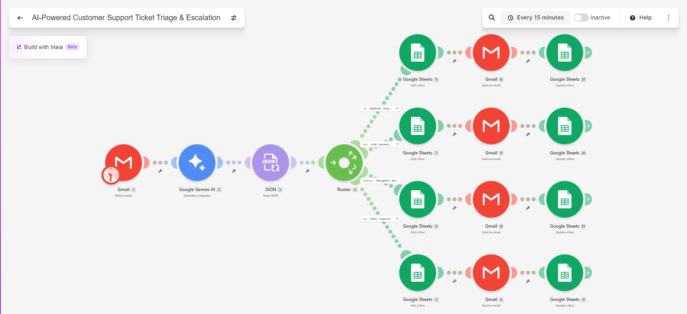
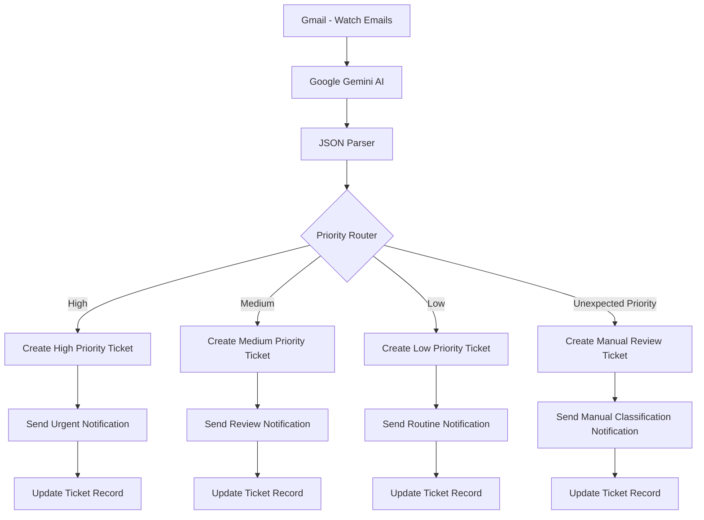
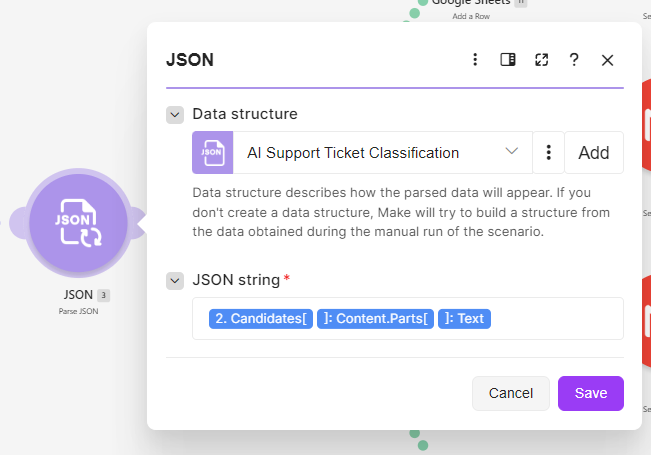
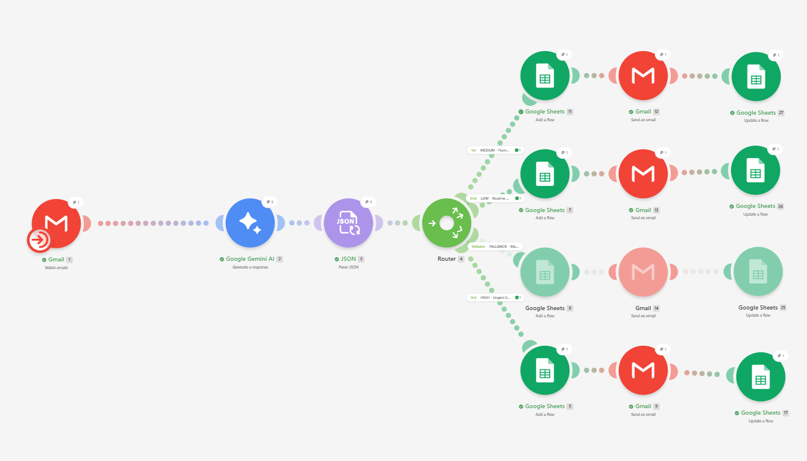
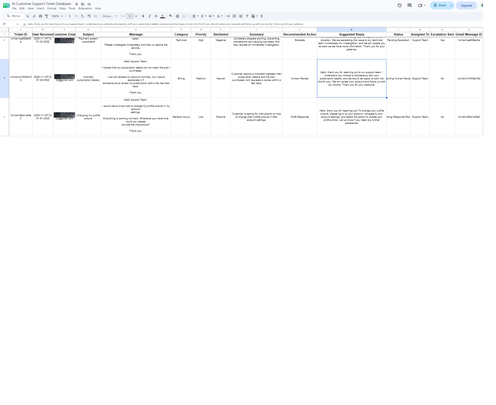

# AI-Powered Customer Support Ticket Triage & Escalation

### Intelligent Customer Support Automation Using Make.com, Google Gemini AI, Gmail & Google Sheets

An AI-powered workflow automation project designed to streamline customer support operations by automatically analyzing incoming customer inquiries, classifying tickets, determining priority, recommending appropriate actions, and notifying internal support teams.

---

## Project Overview

Customer support teams often spend significant time manually reviewing, categorizing, and prioritizing incoming customer emails.

This project demonstrates how artificial intelligence and workflow automation can help reduce repetitive manual activities while maintaining human oversight over customer communications and critical support decisions.

## Business Objectives

- Automate customer support ticket classification.
- Identify urgent and high-priority customer concerns.
- Reduce repetitive manual ticket processing.
- Standardize support ticket prioritization.
- Centralize customer support records.
- Generate AI-assisted response drafts.
- Notify support teams based on ticket priority.
- Route unexpected classifications for manual review.

---

## Technology Stack

| Technology | Purpose |
|---|---|
| Make.com | Workflow automation and orchestration |
| Google Gemini AI | AI-powered classification and response generation |
| Gmail | Incoming customer inquiries and internal notifications |
| Google Sheets | Centralized support ticket database |
| JSON Parser | Structured AI response processing |
| Make.com Router | Conditional workflow routing |

---

## Workflow Architecture



The workflow consists of 16 connected modules and four conditional processing routes.



---

## Key Features

### 1. Automated Email Processing

The workflow monitors incoming Gmail messages using a dedicated support email label.

Customer email information is extracted and passed to the AI classification module.

### 2. AI-Powered Ticket Classification

Google Gemini AI analyzes customer inquiries and generates structured information containing:

- Category
- Priority
- Sentiment
- Summary
- Recommended action
- Suggested customer response

Supported categories include:

- Billing
- Technical
- Refund
- General Inquiry
- Other

### 3. Structured JSON Processing

The AI-generated response is parsed using a predefined JSON data structure.

This allows individual response fields to be mapped consistently into downstream workflow modules.

### 4. Conditional Ticket Routing

| Priority | Processing Action | Ticket Status |
|---|---|---|
| High | Send urgent escalation notification | Pending Escalation |
| Medium | Notify support team for investigation | Pending Human Review |
| Low | Generate routine support notification | Pending Response Review |
| Fallback | Request manual classification | Needs Manual Classification |

### 5. Centralized Ticket Database

All successfully processed customer inquiries are recorded in Google Sheets.

The database contains:

| Field | Description |
|---|---|
| Ticket ID | Unique source Gmail message identifier |
| Date Received | Customer email received date |
| Customer Email | Customer email address |
| Subject | Original email subject |
| Message | Original customer inquiry |
| Category | AI-generated ticket category |
| Priority | AI-generated ticket priority |
| Sentiment | Customer sentiment |
| Summary | AI-generated inquiry summary |
| Recommended Action | Suggested support action |
| Suggested Reply | AI-generated response draft |
| Status | Current ticket processing status |
| Assigned To | Responsible support team |
| Escalation Sent | Urgent escalation notification indicator |
| Gmail Message ID | Source email reference |

### 6. Automated Internal Notifications

The workflow sends priority-based notifications to the internal support team.

Notification types include:

- URGENT SUPPORT TICKET
- SUPPORT REVIEW REQUIRED
- ROUTINE SUPPORT TICKET
- MANUAL CLASSIFICATION REQUIRED

Customer response drafts are generated for human review. The workflow does not automatically send AI-generated replies to customers.

### 7. Fallback Processing

Unexpected priority classifications are routed to a dedicated fallback path.

The support team receives a manual classification notification, allowing staff to review tickets that cannot be routed through the standard priority rules.

---

## AI Configuration


The AI prompt includes classification rules and response-generation safeguards.

These instructions are designed to:

- Return structured JSON output.
- Classify inquiries according to urgency and business impact.
- Generate professional and empathetic response drafts.
- Avoid unsupported promises of refunds or resolutions.
- Avoid inventing company policies or customer information.
- Treat incoming customer messages as untrusted input.

### JSON Parser Configuration



The parser converts the AI-generated JSON response into structured fields for downstream processing.

### Router Configuration

| Route | Filter Configuration |
|---|---|
| High | [View Configuration](images/router-filter-high.png) |
| Medium | [View Configuration](images/router-filter-medium.png) |
| Low | [View Configuration](images/router-filter-low.png) |
| Fallback | [View Configuration](images/router-filter-fallback.png) |

---

## Testing and Quality Assurance

The workflow was functionally tested using controlled customer support scenarios.

Testing focused on AI classification, conditional routing, database integration, notification delivery, batch processing, and fallback behavior.

### Test Execution Summary

| Test Scenario | Expected Result | Status |
|---|---|---|
| High-priority security concern | Urgent escalation route | PASS |
| Medium-priority billing concern | Human review route | PASS |
| Low-priority general inquiry | Routine support route | PASS |
| Multiple-email processing | Three tickets processed in one execution | PASS |
| Unexpected priority classification | Fallback route executed | PASS |
| Database record creation | Ticket information recorded | PASS |
| Internal email notifications | Appropriate notifications delivered | PASS |
| Ticket record update | Escalation indicator updated | PASS |

The results represent controlled functional testing and do not imply exhaustive production validation.

### Batch Processing Test

Three customer inquiries representing different priority levels were processed during a single workflow execution.

| Customer Inquiry | Priority |
|---|---|
| Payment system unavailable | High |
| Incorrect subscription details | Medium |
| Changing my profile picture | Low |

#### Workflow Execution Evidence



#### Database Validation



#### Email Notification Validation


### Negative Testing - Fallback Route

A controlled test was performed by temporarily configuring the AI prompt to return an unexpected priority value of `Unknown`.

The test verified that an unexpected but valid JSON classification was routed to the manual review path.

Expected results:

- Fallback route executed.
- Ticket recorded in Google Sheets.
- Ticket status set to Needs Manual Classification.
- Manual review notification delivered.
- Standard priority routes skipped.

The original AI classification prompt was restored after testing.

#### Fallback Execution Evidence


#### Fallback Database Validation


#### Fallback Email Notification


---

## Business Value

This automation is designed to support businesses by:

- Reducing repetitive email classification activities.
- Helping support teams identify urgent customer concerns.
- Improving consistency in ticket prioritization.
- Centralizing support records for easier monitoring.
- Supporting faster initial ticket assessment.
- Maintaining human oversight of customer responses.
- Improving workflow traceability.

Potential use cases include:

- E-commerce customer support
- SaaS customer service
- IT helpdesk operations
- Internal service desks
- Small business support teams
- Client service agencies

---

## Project Structure

```text
02-ai-customer-support-ticket-triage/
├── README.md
├── blueprint/
│   └── customer-support-triage.json
├── docs/
│   ├── WORKFLOW_ARCHITECTURE.md
│   ├── TEST_PLAN.md
│   ├── TEST_CASES.md
│   ├── EXECUTION_RESULTS.md
│   └── SETUP_GUIDE.md
└── images/
    ├── final-workflow-architecture.png
    ├── batch-processing-execution.png
    ├── batch-processing-database-validation.png
    ├── batch-processing-email-notifications.png
    ├── fallback-execution-success.png
    ├── fallback-database-validation.png
    ├── fallback-email-notification.png
    ├── gemini-ai-configuration.png
    ├── json-parser-configuration.png
    ├── router-filter-high.png
    ├── router-filter-medium.png
    ├── router-filter-low.png
    └── router-filter-fallback.png
```

---

## Technical Documentation

- [Workflow Architecture](docs/WORKFLOW_ARCHITECTURE.md)
- [Test Plan](docs/TEST_PLAN.md)
- [Test Cases](docs/TEST_CASES.md)
- [Execution Results](docs/EXECUTION_RESULTS.md)
- [Setup Guide](docs/SETUP_GUIDE.md)

## Make.com Blueprint

The exported workflow blueprint is available for reference:

[Download Workflow Blueprint](blueprint/customer-support-triage.json)

Users importing the blueprint must configure their own application connections, email settings, spreadsheet mappings, and AI credentials.

---

## Known Limitations

- Persistent duplicate ticket prevention is not yet implemented.
- Malformed JSON and AI API failures require additional error-handling mechanisms.
- Partial execution failures may require manual recovery.
- AI classification accuracy depends on the quality of incoming messages and model responses.
- Prompt-based safeguards do not guarantee protection against all prompt injection attempts.
- Scheduled production operation has not been validated.
- The Google Sheets database is intended for demonstration and small-scale ticket processing.

## Future Enhancements

- Persistent duplicate detection and idempotency.
- Automated retry and error-handling routes.
- Dedicated error logging and monitoring.
- SLA-based escalation and follow-up reminders.
- AI classification confidence scoring.
- Integration with CRM and helpdesk platforms.
- Support analytics and reporting dashboards.
- Human approval workflows for customer responses.
- Production-scale database integration.

---

## Skills Demonstrated

- AI Workflow Automation
- Make.com Scenario Development
- Generative AI Integration
- Prompt Engineering
- JSON Data Processing
- Conditional Workflow Routing
- Business Process Automation
- Application Integration
- Exception Routing
- Functional Testing
- Negative Testing
- Batch Processing Validation
- Technical Documentation

---

## Project Status

Completed and functionally validated as a portfolio MVP.

The scenario demonstrates AI-assisted customer support automation with conditional ticket routing, centralized record management, and internal notifications.

---

## Author

**Janessa Balontong**

QA Automation Engineer | AI Automation Specialist

Focused on building reliable software, intelligent workflow automation, and scalable business process solutions.

[GitHub Profile](https://github.com/janessa2297)

---

*This project was developed for portfolio and demonstration purposes using controlled customer support scenarios.*
